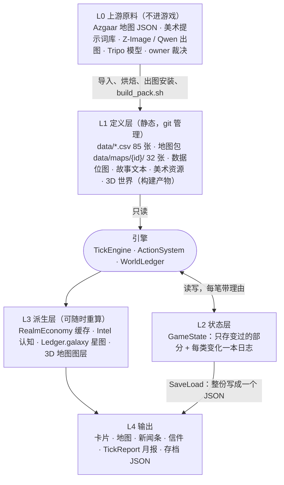
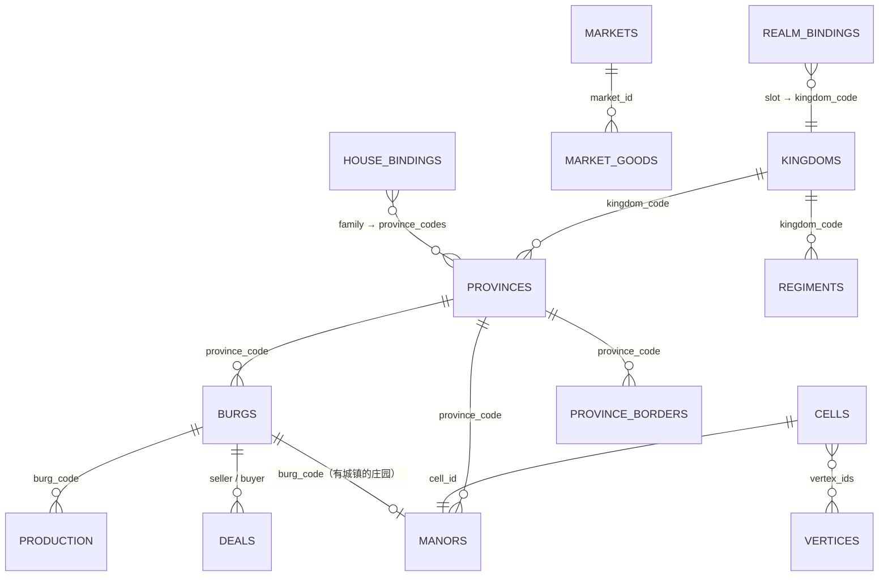
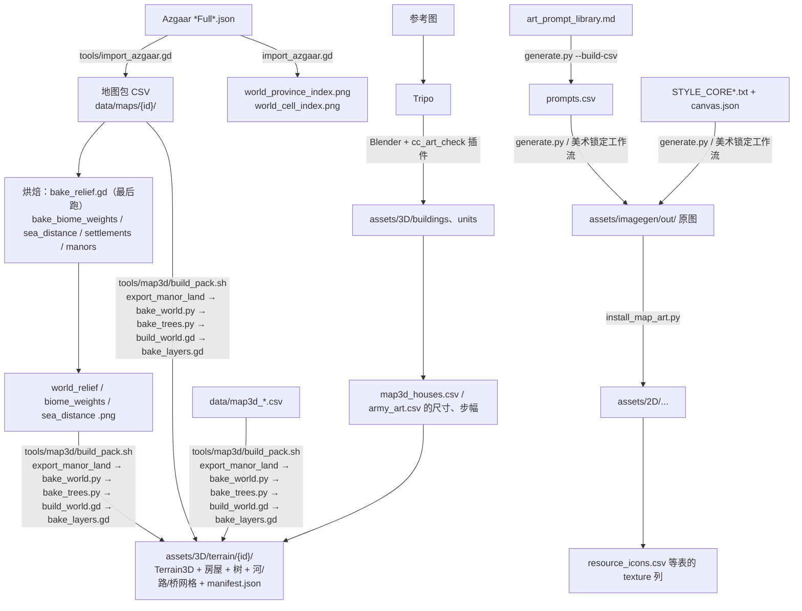
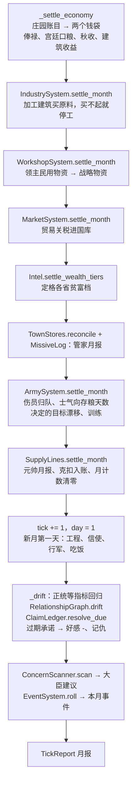
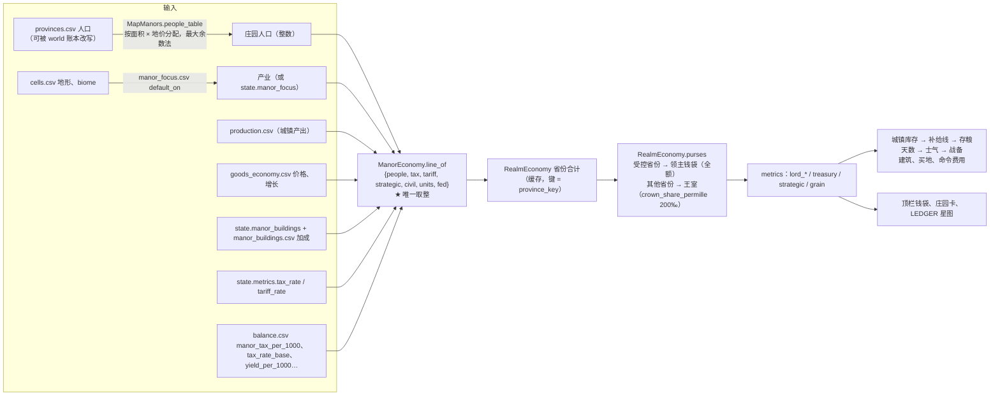
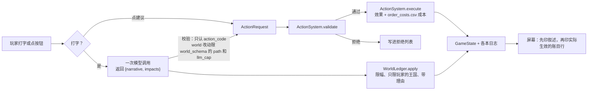

# 《王冠与议会》数据架构、Schema 与数据血缘

> 现状文档，2026-10-01，以分支 `claude/lucid-cerf-1tx264` 的代码为准。
> 目标需求见 [`data_architecture_requirements.md`](data_architecture_requirements.md)（2026-09-11 的需求与 §11 的落地对照）；
> 本文写的是**现在实际怎么存、怎么流、改一处会牵动哪里**。每个结论都标出了代码位置，代码变了以代码为准。

---

## 0. 一页看懂

游戏的数据分五层：上游原料经过**构建**变成定义层，定义层在运行时和**状态层**一起被引擎读取，算出**派生层**，最后呈现到界面和存档。



三条贯穿全局的规则：

1. **定义和状态分开。** 定义层只读；状态层只记录"和定义不一样的地方"。没动过的省份、庄园、世界字段在状态里根本不出现，读的时候回落到定义层。
2. **每一次改动都带理由。** 好感、领土、庄园、世界字段、账目，每次写入都有一条带 `reason` 的日志（不变量 4）。
3. **确定、整数、一次取整。** 一个种子化的随机流（`GameState.rng`）；经济只在庄园一级取整一次，省和王国都是整数相加（不变量 2、11）。

---

## 1. 五层数据

| 层 | 是什么 | 在哪 | 谁写 | 改了要做什么 |
| --- | --- | --- | --- | --- |
| L0 上游原料 | Azgaar 地图 JSON、提示词库、生成的原图、Tripo 原始模型、owner 的裁决 | `assets/maps/<id>/*Full*.json`、`docs/references/`、各 `model_wip/`（git 忽略） | 人和外部工具 | 重新导入或重新安装 |
| L1 定义层 | 规则和内容：所有数值、表、地图包、故事文本、美术 | `data/`、`data/maps/<id>/`、`assets/`、`RANDOM_EVENTS.md`、`game_story/` | 人、导入器、安装脚本、构建脚本 | 多数只要重启游戏；3D 外观相关的要重建世界（§6） |
| L2 状态层 | 一局游戏此刻的样子 | `GameState`（`scripts/engine/game_state.gd`）、`Character` | 只有引擎（`Game` 自动加载单例经 `ActionSystem` / `TickEngine` / `WorldLedger`） | 新字段要进 `to_dict` / `from_dict` |
| L3 派生层 | 由 L1 + L2 算出来、可丢弃的结果 | `RealmEconomy` 缓存、`Intel`、`Ledger.galaxy`、`MapOwnership` 的边界线、3D 图层 | 引擎和视图 | 不用管，输入变了自动重算 |
| L4 输出 | 玩家看到的和存下来的 | 界面、3D 地图、新闻条、信件、存档 JSON、`TickReport` | 界面层（只读状态） | — |

---

## 2. Schema

### 2.1 定义层：`data/*.csv`（85 张，按领域）

全部由 `DataRepository`（`scripts/engine/data_repository.gd`）在启动时读入内存；`data/` 下有 `.gdignore`，Godot 不会把它们当翻译文件导入。**设计数值只能放在这里，不能写死在脚本里。**

| 领域 | 主要表（行数） | 主键 | 主要读者 |
| --- | --- | --- | --- |
| 平衡总表 | `balance.csv`（990） | `key` | 几乎所有系统，`data.bal("key")` |
| 宫廷人物 | `founding_council`（5）、`roles`（16）、`character_traits`（45）、`council_seats`（9）、`relationships`（49）、`templates`（159） | `id` / `trait_code` / `seat_code` | `CharacterFactory`、`OpinionDrift`、`RelationshipGraph`、对白模板 |
| 命令与成本 | `policy_actions_court_additions`（28）、`policy_actions_domain`（8）、`action_signatures`（34）、`order_costs`（38）、`metric_polarity`（17） | `action_code` / `metric` | `ActionSystem`、`OrderCosts`、`OrderPipeline` |
| 世界账本与认知 | `world_schema`（44）、`world_rules`（8）、`claim_types`（7）、`facts`（9）、`intel_facts`（9） | `path` / `fact_code` | `WorldLedger`（LLM 能改什么、改多少）、`ClaimLedger`、`Intel` |
| 事件 | `events`（20）、`event_choices`（60）、`chapter_events`（21）、`chapter_event_choices`（51）、`chapter_branches`（16）、`faction_escalation`（6） | `event_id` / `choice_id` / `branch_id` | `EventSystem`、`EventEffects`、`TriggerDsl` |
| 庄园与经济 | `manor_focus`（12）、`manor_buildings`（23）、`building_inputs`（8）、`manor_estates`（36）、`goods_economy`（71）、`goods_economy_defaults`（16）、`workshop_rates`（3） | `focus_code` / `building_code` / `good_code` | `MapManors`、`ManorEconomy`、`RealmEconomy`、`IndustrySystem`、`WorkshopSystem` |
| 治理（LEDGER） | `ledger_governance`（4）及 `ledger_*` 其余 9 张 | `flow_type` / `type_id` / `link_id` | `Governance`、`Ledger`、`LedgerResolvers` |
| 军事、信使、天气 | `army_*`（11 张）、`unit_models`、`courier_kinds`、`road_speed`、`spy_difficulty`、`weather`、`weather_odds` | `arm` / `tier` / `kind` | `ArmySystem`、`SupplySystem`、`CourierSystem`、`SpySystem`、`Weather` |
| 法律 | `laws`（18）、`law_effects`、`law_words`、`conduct_words` | `law_code` | `LawSystem`（状态：`law_decree`、`law_in_force`、`law_cooldown`） |
| 3D 地图外观 | `map3d_bake`（150）、`map3d_fields`（37）、`map3d_farm_zones`、`map3d_houses`（17）、`map3d_house_variants`、`map3d_trees`、`map3d_tree_crowns`、`map3d_settlements`、`graphics_quality`（4）、`terrain_palette`（68） | `key` / `type` / `tier` | 构建脚本 `tools/map3d/` 和 `scripts/map3d/` |
| 界面外观 | `political_palette`（62）、`chart_palette`、`ui_table_palette`、`ui_bookmarks`、`ui_fonts`、`resource_icons`（104）、`manor_card_sections`、`goods_palette`、`goods_art`、`*_art.csv` | `key` | `UiPalette`、`MapPalette`、各面板 |
| 地图包注册 | `maps.csv`（1） | `map_id` | `DataRepository.default_pack_id()`、`tools/packs.py` |

### 2.2 定义层：地图包 `data/maps/<id>/`（以 `beria` 为例）

由 `tools/import_azgaar.gd` 从 Azgaar JSON 生成（四张手工维护的绑定表除外），坐标就是 JSON 自己的像素坐标（beria 是 2560×929，1 像素约 1 公里）。



| 域 | 表（行数） | 说明 |
| --- | --- | --- |
| 根目录（手工） | `map_info`（5）、`realm_bindings`（4）、`house_bindings`（7）、`manor_name_overrides`、可选 `arms_bindings` | 把故事里的 `{player_realm}` 等槽位绑到具体王国；把宫廷家族绑到省份。**导入器从不写它们** |
| `geography/` | `cells`（4,833）、`vertices`（9,892）、`biomes`（13）、`coasts`、`rivers`（180）、`routes`（557）、`markers` | 地形本身。格子就是地面，没有渲染图 |
| `political/` | `kingdoms`（7）、`provinces`（203）、`burgs`（684）、`manors`（3,500）、`borders`、`province_borders`（212）、`diplomacy`、`campaigns` | 开局的政治格局。**开局**归属，之后的变化在状态层 |
| `economy/` | `provinces`（人口）、`burgs`、`goods`（71）、`production`（5,061）、`markets`（27）、`market_goods`（1,917）、`deals`（10,815）、`kingdoms` | 人口、城镇产出、市场、贸易流 |
| `military/` | `kingdoms`、`regiments`（82）、`unit_types` | 开局兵力 |
| `society/` | `cultures`、`religions`、`zones` | 文化、宗教、区域 |

配套的数据位图在 `assets/maps/<id>/`：`world_province_index.png`、`world_cell_index.png`（点击命中测试，导入器生成）以及 `world_relief.png`、`world_biome_weights_*.png`、`world_sea_distance.png`（烘焙生成）。它们是**数据**，必须无损导入，测试会拦。

### 2.3 状态层：`GameState`

核心原则是 **overlay**：只存"和地图包不一样"的部分，并且每类变化配一本日志。

| 字段 | 形状 | 含义 | 写入者 | 存档 |
| --- | --- | --- | --- | --- |
| `tick` / `day` | int | 月份（1 月 = 30 天）/ 月内第几天 | `TickEngine` | 是 |
| `rng` | `Rng` | 唯一的种子化随机流 | 引擎 | 是 |
| `metrics` | metric → float | 王室三池（`treasury` / `strategic` / `grain`=民用）、领主三池（`lord_gold` / `lord_strategic` / `lord_civil`）、税率、关税、正统、动乱、军队素质、教会、民心等。全部键由 `default_metrics` 一处定义 | `TickEngine._apply`（每笔带理由）、`ActionSystem` | 是 |
| `characters` / `council` | id → `Character` / seat → id | 人物：属性、技能、意识形态、特质、好感 + `opinion_log`、`attribute_log`、`flags` | `CharacterFactory`、`OpinionDrift`、动作 | 是 |
| `relationships`、`knowledge`、`source_trust`、`claims`、`agent_memory` | 数组 / 字典 | 人际关系、谁知道什么事实、对消息来源的信任、待核实的说法、每个人记得听过什么 | `RelationshipGraph`、`KnowledgeBase`、`ClaimLedger`、`AgentMemory` | 是 |
| `province_owner` + `territory_log` | province → kingdom（只存易主的） | 领土变化，经 `MapOwnership.set_owner`（必须带理由） | 征服、事件 | 是 |
| `world` + `world_log` | path → value（只存变过的） | 世界账本：LLM 和事件能改的字段，受 `world_schema.csv` 限幅 | `WorldLedger.apply` | 是 |
| `manor_owner`、`manor_province`、`manor_buildings`、`manor_works`、`manor_focus` + `manor_log` | cell id（字符串）→ … | 庄园易主、跨境并入、已建建筑、在建工程、选定产业 | `MapManors`、庄园命令 | 是 |
| `idle_buildings` | cell → [building] | 本月缺原料停工的建筑，每月整体重写 | `IndustrySystem.settle_month` | 是 |
| `workshop_rate`、`closed_routes` | — | 军工坊开工率、被关闭的贸易路线 | 命令 | 是 |
| `governors`、`skims`、`caught`、`records` | — | 谁管哪条流、贪了多少（真相）、被审计抓到的记录、永久档案 | `Governance`、`LEDGER_AUDIT` | 是 |
| `regiments` | code → {位置（整米）、目的地、命令、士气、伤员、补给（整单位）、`carry_days`（携带天数命令）、训练} | 玩家的部队 | `ArmySystem`、信使送达的命令 | 是 |
| `forage_stripped`、`grievance`、`conduct_marks` | 省 → ‰ / 王国 → 点数 / 键 → 月份 | 被就地征粮刮薄的省、劫掠积下的怨恨（目前只显示）、每月一次的标记；部队另有 `forage`、`forage_days`、`deserted`、`desert_rem` | `ArmyConduct` | 是 |
| `town_stock` | burg → {crown, lord, house}（整补给单位） | 各己方城镇自己的战略物资库存；`metrics.strategic` / `lord_strategic` 是 crown / lord 两项之和折成的金 | `TownStores`（月末存入、`reconcile`）、`SupplyLines`（每日扣减） | 是 |
| `supply_lines` | regiment code → {town, rate, state, 月计数…} | 每支部队至多一条补给线（ordered / riding / flowing / cut） | `SupplyLines`、补给命令送达 | 是 |
| `couriers` / `next_courier_id` | 数组 | 路上的信使（编号越大命令越新） | `CourierSystem` | 是 |
| `missives` / `next_missive_id` | 数组 | 收到的信：回执、月报、密探报告、审计 | `MissiveLog` | 是 |
| `wealth_tiers` | province → 0/1/2 | 各省贫富三档，每月结算后定格 | `Intel.settle_wealth_tiers` | 是 |
| `event_state`、`pending_event`、`cooldowns`、`promises`、`recent_outcomes` | — | 事件调度、冷却、承诺 | `EventSystem`、`ActionSystem` | 是 |

### 2.4 存档

`SaveLoad.save_game` 把 `GameState.to_dict()` 整个写成**一个 JSON 文件**（不变量 7），当前 `SAVE_VERSION` 为 5。所有浮点数经 `_encode_values` 编码成 `"f" + 16 位十六进制`（float64 的原始位），保证读回来逐位相同、确定性不依赖 JSON 的浮点精度。部队位置用整数米，也是同一个理由。旧存档缺字段时，`from_dict` 回落到默认值（例如 `day` 读成 1，`wealth_tiers` 由 `Intel.ensure_wealth_tiers` 补算）。

---

## 3. 数据血缘

### 3.1 构建期：原料怎么变成游戏能读的定义



要点：

- 3D 世界的 `manifest.json` 里有 `steps_hash`（烘焙表的指纹）。改了参与烘焙的表，世界就会被判为 `stale`，地图面板会提示重跑 `build_pack.sh`。
- **地面上的田地图案是构建期按庄园的开局默认产业烘焙的**（`export_manor_land.gd` 写出 `MapManors.default_focus`）。玩家后来改产业，经济会变，地面不会变。

### 3.2 运行期：一天和一个月

时钟由 `GameRoot._process` 驱动，经 `Game.advance_day`；第 30 天结束就是月结算。

**每一天**（`TickEngine.advance_day`），按这个顺序：

1. `MapManors.advance_works`：工程推进，完工的进 `manor_buildings`。
2. `ArmySystem.march_day`：部队行军，到达目的地自动驻防。
3. `CourierSystem.ride_day`：信使在部队行军之后走，当天送到的命令从次日起执行。
4. `SupplyLines.day_step`：城镇给驻扎的部队补满携带量；补给线的状态、截断、送达与运费。
5. `ArmySystem.eat_day`：部队吃掉一天的补给；`hunger_day`：存粮不足 5 天则每天掉士气；`SupplyLines.warn_day`：低粮、断粮、城镇库存告急的警告。
6. `RealmEconomy.step_day`：把本月的经济计算分摊到当天的省份桶里。当天的补给消息合成**一封**快报（`MissiveWriter.supply_dispatch`）。

**月末**（`TickEngine.advance`），先结算刚结束的月，再翻月：



顺序本身就是规则：例如关税放在工坊之后，是为了"本月收入全部入账之后才开始花"；士气的月度漂移读的是当月最后一天吃完后的存粮天数；每日的补给消耗与饥饿惩罚在 `advance_day` 里发生。

### 3.3 一个庄园的一个月：经济血缘

经济的唯一取整点是 `ManorEconomy.line_of`（一个庄园一个月的账）。往上全是整数加法。



税的公式（`manor_economy.gd` 的注释）：

```text
tax = round(people / 1000 × manor_tax_per_1000 × tax_rate / tax_rate_base × (1 + Σ tax_bonus))
```

省份缓存的键（`RealmEconomy.province_key`）由月份、税率、关税、该省城乡人口，以及省内每个庄园的易主 / 建筑 / 产业 / 停工状态拼成。**任何一项变了，只有这个省重算**，其他省直接读缓存。

### 3.4 命令血缘：玩家的一句话怎么变成状态



`OrderPipeline.apply_order` 是这条链的唯一入口。因为界面最后印的是"实际生效的账目"，模型叙述里夸大的部分一眼就能看出来（不变量 8）。

### 3.5 认知血缘：真相和"你以为的真相"

状态层存的是**真相**。玩家看到的是经过 `Intel` 过滤后的**认知**：

- 自己控制的省份和自己的部队：精确数字（`full`）；
- 王国内其他省份：只有文字档（"数千人"、富 / 中 / 穷，`general`）；
- 国外：只有归属、外交态度、贫富（`basic`）；
- 某地最新的一份密探报告会覆盖文字档，显示估计区间并注明来源和日期；
- DEV MODE 直接看真相。

LEDGER 星图（`Ledger.galaxy`）同样只画认知：官员报给你的数字、审计查出来的数字，两者不一致时画成两股线。

---

## 4. 变更影响示例

每个例子按"改了什么 → 怎么传导 → 最后看到什么 → 要不要额外操作"来写。

### 例 1：把税率从 5 调到 6（运行时状态）

- **改了什么**：`metrics.tax_rate` 5 → 6（命令 `LAW_SET` 颁布法律 `tax_rate`；`metrics.tax_rate` 是颁布值的镜像，颁布即更新，各省的在行值随信使到达而更新）。
- **怎么传导**：
  - `tax_rate` 是每个省缓存键的一部分，所以**全部省份**的缓存失效，按天分摊重算。
  - 每个庄园的税 × 6/5。一个 1,500 人、无建筑的庄园：1.5 × 2 × 5/5 = 3 金 → 1.5 × 2 × 6/5 = 3.6，取整 4 金。
  - 月末受控省份的税全额进 `lord_gold`，其他省份的 200‰ 进 `treasury`，`tax_income` 记下两者之和。
- **最后看到**：顶栏两个钱袋的月增量变大；庄园卡的税额变化；LEDGER 上缴税流的卡片数字变化。
- **额外操作**：无。

### 例 2：跨境买下一个庄园（运行时状态，牵动最广）

- **改了什么**：`MANOR_BUY` 买下一个只和本国接壤的外国庄园。状态里写入：`manor_owner`（新主人）、`manor_province`（并入接壤省份中税收最高的那个）、`manor_log`（带理由）。钱从**国库**付。
- **怎么传导**：
  1. `MapManors.province_of` 现在把这个格子算进本国省份。
  2. `MapOwnership.province_loops` 按边的奇偶把格子并进省界，于是**国界、省界缝线、王国色带都重画**。
  3. 原省份和新省份的 `manors_of_province` 都变了，两省的缓存键都变，两省重算。人口按面积 × 地价重新分配，省内人口总和仍然精确。
  4. 如果这让某个家族在该省持有的庄园最多，`MapManors.controller_of` 会翻转，**受控省份集合**随之变化，于是"领主钱袋全额 / 王室抽成 200‰"的划分也变。
  5. 受控省份在 `Intel` 里升为 `full`：这个省的卡片从文字档变成精确数字。
  6. 下个月 `Intel.settle_wealth_tiers` 重算贫富档；LEDGER 里庄园折叠到新的省份星上。
- **最后看到**：地图边界线移动、庄园换颜色、两个钱袋的月收入变化、省卡变得精确。
- **额外操作**：无。领土就是状态（不变量 6），不需要新美术。

### 例 3：玩家把一个庄园的产业从谷物改成铁矿（运行时状态）

- **改了什么**：`MANOR_FOCUS` 写入 `manor_focus[cell] = {focus, since}`。
- **怎么传导**：新产业按 `manor_focus.csv` 的 `transition_ticks` 逐月爬升；产出从民用池转到战略池（`goods_economy.csv` 决定归哪个池）。月末产出按辖区归属存进各城镇的库存（`TownStores.deposit_month`，`town_stock`）；部队只从**玩家指定的补给点**（补给线）或所在的己方城镇取粮，补给线每天按速率从该城镇扣库存。所以战略物资变多只在**补给点所在城镇原本不够供**时起作用：那时部队每天拿到的补给变多 → 存粮天数 → 士气和行军拖累 → 战备（红条）上升 → 行军速度和战斗胜算上升；库存本来就够，多出来的只是存着。民用池变少 → 军工坊可转化的原料变少；民用池见底时宫廷口粮按规则核销。
- **最后看到**：庄园卡产出、地图上该庄园的产出徽章、LEDGER 的物资流。
- **不会变的**：地面的田地图案。它是构建期按开局默认产业烘焙的。

### 例 4：撤换补给线的主管（运行时状态，治理链）

- **改了什么**：`GOVERNOR_SET` 把补给线交给一个行政技能低、品行贪婪的大臣，写入 `governors`；被跳过的人和新主管的好感各记一笔（带理由）。
- **怎么传导**：
  - `Governance.factors` 按新主管的技能（对比 `ledger_governance.csv` 的 `skill_mid`）和好感算出效率上限；
  - `Governance.skim_of` 给贪婪者一个**固定**比例的克扣（不随机），每月记进 `skims[人][flow]`，但上报给你的数字照旧是全额；
  - 实际送达部队的补给变少 → 补给档 → 士气 → 战备依次下降。
- **最后看到**：LEDGER 上主管报的数字看起来正常，部队的黄条却在掉。`LEDGER_AUDIT` 会把真相写成一封审计信（"N（他报的是 M）"），抓到的人记进 `caught` 和永久档案 `records`，LEDGER 上的线分成两股。
- **额外操作**：无。

### 例 5：改 `balance.csv` 的一个数（定义层，纯数值）

- **改了什么**：`army_supply_gold_permille` 100 → 150（补给每月的花费系数）。
- **怎么传导**：一个补给单位的金价 × 1.5 → 战略指标（库存折金）、向房屋买粮的价格、元帅月报里的金额同步变化；补给线的运费按 `supply_cart_milligold_per_unit_km` 另算，不受影响。
- **额外操作**：重启游戏即可，不用重建世界。相关的 GUT 测试如果写死了期望值，要更新。

### 例 6：改房屋表 `data/screens/map3d/map3d_houses.csv`（定义层，3D 外观）

- **改了什么**：把 `cottage_a` 的 `height_m` 改了，或者换了一个新的 GLB。
- **怎么传导**：
  - 测试 `test_map3d_houses_meshes.gd` 断言网格高度和表里一致（±0.6 m）、占地填满、没有超过 1 m 的洞——对不上就失败；
  - 房屋表参与 3D 世界的 `steps_hash`，世界被判为 `stale`，地图提示重建；
  - 美术插件的 `specs.json` 里存着这张表的副本（面数上限、占地），过期了会按旧规格检查。
- **额外操作**：`tools/map3d/build_pack.sh`；`python3 tools/art_kit/extract_specs.py` 和 `python3 tools/art_kit/build_kit.py`；跑测试。

### 例 7：改 2D 风格文字 `assets/imagegen/STYLE_CORE.txt`（美术定义）

- **改了什么**：风格核心里改了一个词。
- **怎么传导**：只影响**以后**生成的图：`generate.py` 拼提示词时读它；美术锁定工作流里的①框是它的拷贝。已经装进游戏的图不会变。
- **风险**：新旧图风格不一致。人物、事件、庄园、图标四类共用这一份风格，一改全都受影响。
- **额外操作**：`python3 tools/art_kit/build_kit.py` 重建工具包（本地版和 Cloud 版），通知美术换新工作流；手册的「工作流规格」页要同步；必要时重出旧图。

### 例 8：LLM 在对话里把某省农村人口 +3%（世界账本）

- **改了什么**：模型返回一条世界改动 `economy.provinces.<code>.rural_population`。`WorldLedger.apply` 检查：路径在 `world_schema.csv` 里、幅度不超过 `llm_cap`、只限玩家的王国、带理由。通过后写进 `world` 和 `world_log`。
- **怎么传导**：`RealmEconomy` 读人口时经 `_figure` 先看 `world` 覆盖值，所以这个省的缓存键变了 → 庄园人口重新分配 → 税、产出变化 → 钱袋。
- **最后看到**：屏幕在叙述后面印出这条实际生效的账目行；省卡人口变化。
- **额外操作**：无。如果模型想改的路径不在表里，或者超出上限，会被拒绝并列出来。

### 例 9：一个省被征服（运行时状态，领土）

- **改了什么**：`MapOwnership.set_owner`（必须带理由）写入 `province_owner` 和 `territory_log`。
- **怎么传导**：王国轮廓 = 它持有的各省省界合并，所以边界重画、王国名字的位置重算、地面重新着色；`MapEconomy` 按**当前**归属把产出从一个王国的账上挪到另一个；`MarketSystem` 的贸易路线按当前归属重新建立索引；命中测试读省份索引位图再查当前主人，所以点击立刻正确。
- **额外操作**：无。不需要新美术，也不需要重建世界。

### 例 10：Azgaar 重新导出地图、王国改了名（地图包）

- **改了什么**：重新跑 `import_azgaar.gd`。
- **怎么传导**：故事文本只写 `{player_realm}` 这类槽位，`DataRepository.fill_realms()` 在加载时替换成绑定王国的名字。所以只需要更新 `realm_bindings.csv`（必要时 `house_bindings.csv`）。测试的夹具也从地图包推导王国、首都、道路，不写死名字。
- **风险**：存档的状态层按 `province_code` / `cell_id` 记录。如果重新导出后编号变了，旧存档里的易主记录会对到别的格子上。重新导出后旧存档应视为不兼容。
- **额外操作**：按 `tools/NEW_MAP.md` 的顺序重跑各个烘焙（`bake_relief.gd` 最后跑），再 `build_pack.sh`；跑 `tools/arms_report.gd` 看纹章够不够用。

### 影响速查表

| 改动 ↓ / 影响 → | 经济 | 军事 | 认知（Intel） | 地图边界 | 3D 外观 | 需要重建世界 | 需要重建美术工具包 |
| --- | --- | --- | --- | --- | --- | --- | --- |
| 税率 / 关税 | ✓ | 间接 | | | | | |
| 买卖庄园、并入 | ✓ | 间接 | ✓ | ✓ | 庄园颜色 | | |
| 庄园产业 | ✓ | ✓ | | | 徽章 | | |
| 建筑 | ✓ | 间接 | | | 卡片槽位 | | |
| 主管任免 | ✓ | ✓ | LEDGER | | | | |
| 征服 / 割让 | ✓ | ✓ | ✓ | ✓ | 着色 | | |
| `balance.csv` 数值 | 视键而定 | 视键而定 | | | 视键而定（`map3d_*`） | 少数 `map3d_*` 键 | |
| `map3d_bake` / `fields` / `farm_zones` / `trees` / `houses` | | | | | ✓ | ✓ | 房屋表 ✓ |
| 兵种骨架、GLB | | 外观 | | | ✓ | | ✓ |
| `STYLE_CORE*` / `canvas.json` | | | | | 以后的图 | | ✓ |
| 地图包重新导出 | ✓ | ✓ | ✓ | ✓ | ✓ | ✓ | 房屋、兵种不变 |

---

## 5. 改数据时的检查清单

| 你改了 | 还要做 |
| --- | --- |
| `data/*.csv` 的数值或新行 | 重启游戏；`./run_tests.sh`。新加的列要在 `DataRepository` 里读 |
| `GameState` 加字段 | 加进 `to_dict` / `from_dict`（浮点要过 `_encode_values`），给旧存档一个默认值；需要时提高 `SAVE_VERSION` |
| 一种新的状态变化 | 写一本带 `reason` 的日志，或复用现有的（`manor_log`、`territory_log`、`world_log`、`opinion_log`） |
| 参与 `RealmEconomy.province_key` 的东西 | 新的经济输入必须进缓存键，否则缓存不会失效。`economy_check_full` 设为 1 可以每月全量核对缓存 |
| `map3d_*.csv`、地图包位图 | `tools/map3d/build_pack.sh`；改位图烘焙参数时最后跑 `bake_relief.gd` |
| `Map3DLayerBake.GEOMETRY_SOURCES` 里的脚本 | 提高 `FORMAT`、更新 `GEOMETRY_MD5`、重跑 `bake_layers.gd`（测试会提醒） |
| `STYLE_CORE*`、`NEGATIVE*`、`canvas.json`、`generate.py` 预设 | `python3 tools/art_kit/build_kit.py`，同步手册的「工作流规格」页 |
| `data/screens/map3d/map3d_houses.csv`、兵种 GLB 的骨架 | `python3 tools/art_kit/extract_specs.py`，再 `build_kit.py` |
| 地图包 | 按 `tools/NEW_MAP.md` 的顺序；只改 `realm_bindings.csv` 就能换名字；旧存档视为不兼容 |
| 让 LLM 能改一个新字段 | 在 `world_schema.csv` 加一行（类型、范围、`llm_cap`），不要在代码里开口子 |

---

## 6. 代码位置索引

| 主题 | 文件 |
| --- | --- |
| 定义层加载 | `scripts/engine/data_repository.gd` |
| 状态与存档 | `scripts/engine/game_state.gd`、`scripts/engine/save_load.gd` |
| 日 / 月循环 | `scripts/engine/tick_engine.gd` |
| 命令 | `scripts/engine/order_pipeline.gd`、`action_system.gd`、`order_costs.gd`、`world_ledger.gd` |
| 庄园与经济 | `map_manors.gd`、`manor_economy.gd`、`realm_economy.gd`、`map_economy.gd`、`industry_system.gd`、`workshop_system.gd`、`market_system.gd` |
| 军事与信使 | `army_system.gd`、`supply_system.gd`、`courier_system.gd`、`spy_system.gd`、`weather.gd` |
| 治理与 LEDGER | `governance.gd`、`audit_writer.gd`、`ledger.gd`、`ledger_resolvers.gd` |
| 认知 | `intel.gd`、`missive_log.gd`、`knowledge.gd`、`claims.gd` |
| 领土 | `map_ownership.gd` |
| 构建管线 | `tools/import_azgaar.gd`、`tools/bake_*.gd`、`tools/map3d/build_pack.sh`、`assets/imagegen/generate.py`、`assets/imagegen/install_map_art.py`、`tools/art_kit/` |

## Military personnel ledger

Equipment elements and personnel are separate: `unit_types.crew` converts capacity; ordinary `ArmySplit` land units respect the personnel cap. Military cohorts retain source province and urban/rural population field. `MilitaryRoster` owns atomic enlistment and status transitions; `MilitaryPopulation` derives reservation and available civilians. Recruitment projects and prisoner records reference cohorts rather than copying their people. Cohort partitions are fit, wounded, currently captive, dead and released civilians; their sum stays equal to the cohort's initial population.

Province population includes living mobilized residents and captives. Enlistment reserves, death subtracts from the explicit origin through `WorldLedger`, release removes reservation without creating population. Kingdom urban/rural totals are derived from currently held provinces and reject direct writes. Historical kingdom overrides no longer shadow those totals. `LEVY_RAISE` trains the existing abstract force and pays gold/material costs; only actual recruitment creates personnel.

`military_rosters`, `military_cohorts`, `military_events`, `recruitment_projects`, and `military_migration` are saved as plain integer JSON. Old saves receive empty fields at decode; repository-aware migration is responsible for populating them without re-seeding existing armies. Event tokens and request payloads survive save/load so retries cannot duplicate losses or reservations.
