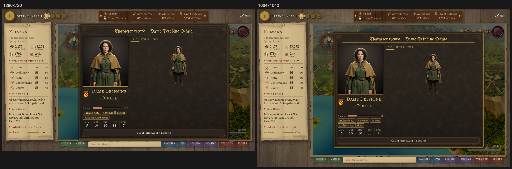
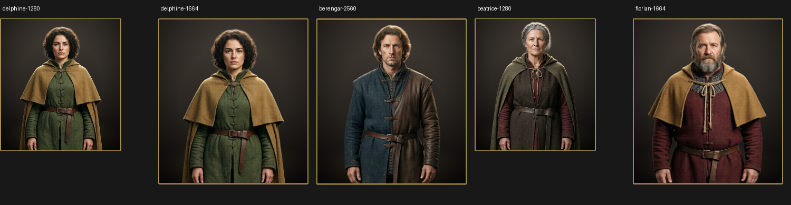
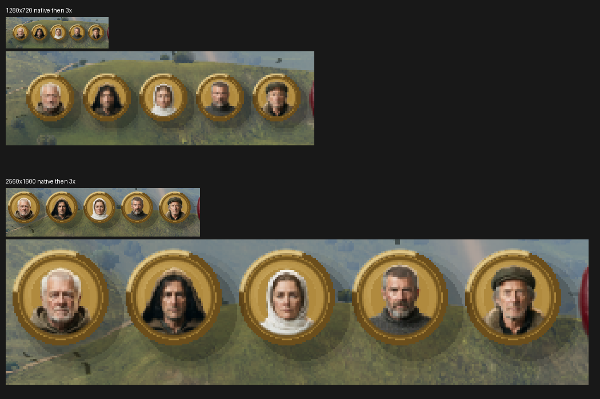

# P2 portrait real-window acceptance

Implementation evidence and independent visual review, 2026-10-20. Current-HEAD CI remains the merge gate. This is the portrait-rendering follow-up to merged PR #124, not whole-P2 acceptance.

## Scope and standard

Read `P2-portraits.md`, P2.3 of the approved roster/recruitment plan, and `.claude/skills/visual-review/taste.md`. Relevant principles: readable faces at playing size, sharp at different window sizes, one sober painterly medium, complete silhouettes, and clean alpha against the actual leather. The reference is the newly installed story cast in the same game dossier. No art, runtime, shared scene look, data or theme was changed.

The existing `snapshot_screen --speaker` audience path skips commanders absent from the current meeting location. The new tool scene has only a Node and script; it adds no layout. It extends the existing snapshot tool, waits for GameRoot's initial screen transition, and calls the existing `_open_character_record` path used by prisoner character records. It asserts the selected character, actual dossier visibility, loaded chip/full assets, real portrait/BIO TextureRects and unchanged serialized campaign state. It does not fabricate a conversation, relocate or appoint anyone, or create replacement UI. This exercises the existing record renderer; it does not prove an active or reserve commander is currently reachable through a prisoner list.

## Captures

All PNGs are real non-headless Godot 4.7.2 Forward+ Metal windows, offline campaign seed 42, day 1, clock paused, frame 40. Runs were serialized with `/Users/samuelzhang/game_design-wt/godot_lock.sh`. The existing editor/game processes in the shared main checkout were left alone.

Evidence directory: [P2-portrait-window](evidence/P2-portrait-window/). `provenance.json` records the exact base HEAD and SHA-256 of source inputs and every approved installed layer. Native captures and corresponding logs are retained (ANSI escapes and trailing whitespace removed from text logs).

- `delphine-1280.png` and `delphine-1664.png`: K-22, player active, age 24, olive complexion, green tunic and ochre mantle; 1280×720 and 1664×1040 (fractional scale).
- `berengar-2560.png`: K-23, player active, age 36, blue/brown fitted clothing; 2560×1600.
- `beatrice-1280.png`: K-24, raider reserve, age 55, grey hair and tied dark clothing; 1280×720.
- `florian-1664.png`: K-80, player reserve, age 59, beard, mail neckline, red tunic and ochre mantle; 1664×1040.
- `chancellor-1664.png`: K-02, story cast, cap and fur-trimmed robe; 1664×1040.
- `council-1280x720.png` and `council-2560x1600.png`: normal story-cast miniature row without the dossier dimmer, using the unchanged original snapshot tool.



`window-comparison.png` fits the two screenshots to the first image's width for comparison; originals retain native resolution. `portrait-crops.png` extracts the actual left portrait panels from the five commander captures and fits them into 285×340 bounds. These are display-scale comparisons, not new art variants. No tuning variant was appropriate for an acceptance-only task with art/layout changes excluded.



## Implementer's observations

The face is the first readable feature in the left portrait; traits, names and skill values remain separate below it. Young/older and clean-shaven/bearded faces remain distinct. All sampled hair and heads fit; the BIO figure retains both hands and boots, with matching identity and clothing. The intentional waist crop in the left panel is different from the whole-figure BIO view. No paper rectangle is visible around the BIO figures on leather. Muted ochre, green, red and blue clothing stays within the installed story cast's medium. At 1280 the whole figure is small, but its silhouette, main garment colour and pose remain readable; facial detail is carried by the larger left portrait.

The left panel's grey gradient is the existing `AudienceBackdrop`, not an opaque source-art background. Grey hair has a bright rim against it; the independent Review should judge this edge in the actual crops, rather than infer alpha quality from code.



The normal council chips keep distinct cap, hair, hood and beard silhouettes at both window sizes. The enlarged row deliberately exposes the native sampling; it is not a claim of additional detail.

## Checks and reproduction

- All **604** records with `review_status == approved_and_installed` match their `installed_sha256`; superseded/rejected sources were excluded. All **287** manifest characters are unique, have both files, and report no missing tier. This is asset coverage, not a new-campaign/old-save roster audit.
- `python3 tools/imagegen/test_commander_portrait_pipeline.py`: five offline regressions pass, including pending-source refusal and exact-ID/hash selection (`pipeline.log`).
- `godot_lock.sh ./run_tests.sh --test tests/ui/test_character_portrait.gd`: seven tests, 17 assertions pass; runner import/runtime/count gates pass (`portrait-gut.log`).
- Hook/selector/runner/timeout Python checks and shell syntax checks pass (`harness.log`). No simulation formula, save format or runtime behavior changed; no broad local GUT was requested for this evidence/tool-only diff.
- Each record capture logs `portrait record verified` and `snapshot ok`, with no script errors. Existing map bake-table staleness, physics-interpolation deprecation and exit ObjectDB warnings are preserved in logs; this PR does not claim a clean map bake or fix those warnings.

From the recorded checkout, with the shared lock, reproduce a record capture:

```sh
/Users/samuelzhang/game_design-wt/godot_lock.sh \
  /Applications/Godot.app/Contents/MacOS/Godot --path . \
  res://scenes/tools/snapshot_portrait_record.tscn -- \
  --screen root --speaker char_player_delphine_o_kala \
  --resolution 1664x1040 --still --out /tmp/delphine.png
```

For normal miniatures use `scenes/tools/snapshot_screen.tscn`, omit `--speaker`, and retain `--screen root --resolution … --still`. Native full PNGs and layer hashes are recorded so the reviewer can inspect exact inputs instead of accepting a resized contact sheet alone.

## Boundaries and follow-ups

`ArmyRecruitmentPanel._add` adds commander names and metadata to an OptionButton; it contains no portrait renderer. Existing unit/battle command surfaces likewise do not provide the three portrait-bearing cards described in the P2.3 plan. Consequently commander-chip readability in recruitment/unit/appointment cards is **not accepted** by these dossier captures. That requires a separate runtime/UI scope, not an invented screenshot. The normal council row covers story chips only; commander chip assets are load/hash-checked here but not presented as player-facing card evidence.

National colours, estate/ordinary-vs-noble samples, every individual portrait, old-save/new-campaign roster equivalence, and P2/P4 phase release are outside this step. No regeneration was performed. The unique Review must independently critique the sheets/native shots against the rubric and record its verdict before merging; defects outside this evidence/tool scope become bounded follow-ups.


## Independent Review

Reviewer: `01a158dd-7883-7651-9ef3-4ae7927e0cf9`, the sole Review for PR #142. Inspected all eight native screenshots, the portrait and council crop sheets, the fixture and its connected `snapshot_screen` / `GameRoot` / `CharacterDossier` / `ConversationScene` paths. Reference: the chancellor in this same dossier, normal council miniatures, and `taste.md`'s readable silhouettes, one medium, muted colours and clean edges. This is an independent critic pass by the second responsible session; no additional reviewer was dispatched.

- **Hierarchy:** the larger left face and its name establish identity first; the smaller BIO figure supports clothing and silhouette without competing with facts.
- **Value:** faces separate from the dark room and leather; Beatrice's dark clothing remains distinguishable, although her boots carry little internal detail at 1280.
- **Colour:** ochre, green, burgundy and blue stay in a restrained family alongside the chancellor; the sampled identities keep visible complexion differences.
- **Medium:** commanders and the story reference share the same textured, realistically modelled portrait treatment; neither looks like a flat icon pasted into the dossier.
- **Edges:** heads, hands and boots are complete in BIO, without rectangular paper residue. Beatrice's grey hair and some shoulder contours have a thin bright rim, also visible on the story reference's cap/fur. This is a source-edge limitation, not evidence of a new renderer defect; these captures do not certify perfect matting for the entire set.
- **Scale:** the larger torso crop carries facial identity and the smaller BIO carries dress. Delphine remains consistent at 1280 and fractional 1664; Berengar's 2560 capture keeps proportions. Story miniatures distinguish hood, cap, hair and beard at both sampled sizes; this does not validate commander chips in absent cards.
- **Sharpness:** large faces and clothing edges remain resolved at fractional size. At 1280 council chips are visibly soft under 3× enlargement, but their native silhouettes remain distinguishable; fine facial detail is not a supported reading at that scale.
- **Noise:** no new badges, frames or ornaments were added. The existing empty BIO area and dossier borders are outside this evidence-only change; they do not obscure the sampled figures.

Verdict: **accept the bounded real-window evidence and minimal snapshot entry**. No blocking code or evidence finding. No new art or layout variant is proposed: this PR changes neither, and the size comparisons test the existing presentation. Keep the bright hair/shoulder rims and small-chip softness as explicit limitations, and retain every exclusion above. This is not whole-P2/P4, all-portrait, commander-card, complexion-spec or gameplay-reachability acceptance.

Integrity check on review inputs: all **614** `sha256` entries and **22** evidence-relative `evidence_sha256` entries in `provenance.json` match disk. The source hashes, retained capture self-checks and targeted test logs remain unchanged from implementation commit `35f803b106406385a090ada8f86bfadfeaf20fb5`; their passing results are reused for this documentation-only review addition. Branch protection was read directly: `harness-checks` and `gut-tests` are required, with no approval count. Merge waits for both plus every selected category on the final PR HEAD.
