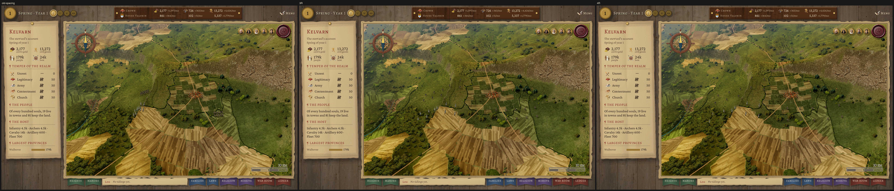
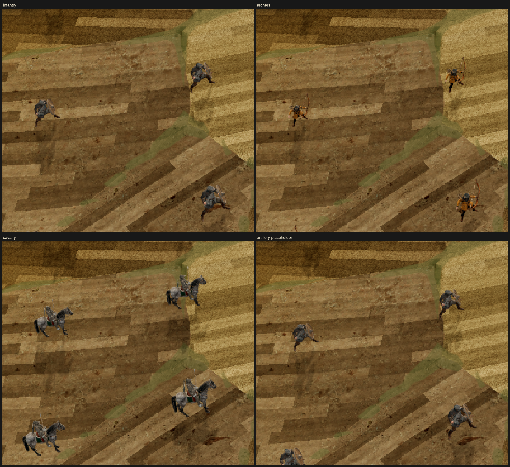

# CF01 — unit body measurement

Scope: read-only measurements of the models currently selected by `GameArt.ARMY_MODELS`; no model, simulation, production CSV, or N1 changes. Implementation: `01a17399-501e-75f3-a168-1a4648c43d23`. Base: `b4415486b8bdec0e6457a32a3db2ab8dfa5d7758` (approved plan #182, design #181). Sole Review: the unique owner recorded in the PR/checkpoint; independent acceptance pending.

The owner explicitly authorized artillery to continue using the infantry placeholder: “先暂时用步兵代替作为placeholder，之后会补上的”. Artillery below means that substitute, **not a measured gun**. Installing real artillery invalidates its envelope, rotation, spacing and visual evidence and requires a fresh measurement before use.

## Calibration and measurement contract

`tools/units3d/measure_unit_bodies.gd` is a `RefCounted` tool. `measure(scene: PackedScene, art: Dictionary) -> Dictionary` requires an explicit repository, FOV, viewport height, reference distance and world-to-simulation ratio in `art`, alongside its ordinary army-art row. Missing models and missing/invalid calibration return `{status: error, error: ...}` rather than invented dimensions.

It uses the same `Map3DUnits.model_size`, `stand_extent` and `scale_for` as the production pieces. The current pack is resolved dynamically. The built world's `m_per_px` divided by `ArmySystem.metres_per_pack_px(repo)` converts simulation metres to world metres. For the frozen inputs this is **0.05 world m / simulation m**: treating local GLB units, drawn world metres and simulation metres as interchangeable would be wrong.

At 1600 px high, FOV 45°, the current reference distance is 10973.6980107868 world m; `map3d_unit_ref_px` is 12. Infantry's source height is 1.60416126251221; its army-art size 0.62 yields world scale 26.3519187631584, hence 527.038375263168 simulation m per local unit. Every arm's exact calibration is retained in `evidence/cf01/measurements.json`. Doubling the **drawn size input** doubles the measured radius; merely changing source units while normalizing by measured source height does not enlarge the drawn figure.

Every nested mesh contributes. Skinned vertices are evaluated on the CPU using each bind's global bone pose and inverse bind pose; an unskinned node uses its full relative transform. The radius is measured around the figure's deployment origin, preserving off-centre horse/equipment overhang. Every imported clip is sampled at 17 inclusive times, including idle, march and available attack/death poses. The resulting circle contains every sampled horizontal vertex at **all yaw angles**, since yaw preserves distance to that origin. The installed GLBs each have one merged mesh. Explicit attack-weapon bind names are audited against their source skin: infantry/artillery `cc_weapon.r`, cavalry `Lance`, royal `Sword`, archers `DEF-weapon.R`. Only vertices whose full skin weight belongs to those named binds are excluded from the body radius; mixed or unclassified vertices stay in the conservative body. A separate `all_mesh_radius_m` retains the unfiltered weapon reach for auditing. Shield, horse, rider and carried equipment remain included. These are candidate upper bounds, not claims of a tight anatomical collision shape.

Production exact-pace stature variation is bounded by `1 + map3d_march_stature_spread`; other arms use 1. Terrain lean is bounded by `map3d_unit_tilt_max_deg`. For a sampled point with horizontal radius `h` and absolute height `v`, the maximum horizontal projection under permitted tilt is its full length if `atan2(v,h)` is within the tilt cap, otherwise `h*cos(cap) + v*sin(cap)`. This bounds every tilt axis and yaw without enumerating a few favourable directions.

The ten home slots are a display proposal (five files, two ranks), with no tactical effect. For rounded-up integer radius `R`, the wider candidate uses lateral/rank pitch `4R`; the empty edge-to-edge lane is `2R`, sufficient for one diameter at exact tangency. Width is `4*pitch + 2R`, depth `pitch + 2R`. The compact comparison uses `3R` and leaves only `R`: an equally large body cannot pass straight between occupied neighbours there. Ten slots remain even when fewer figures are shown; CF01 does not implement casualties or persistence.

## Measurements

Frozen results (simulation metres; radius rounded upward once, then integer pitch/range derived):

- **archers**: sampled body radius 931.426906 → `R=932`; full-mesh radius 931.426906; pitch `3728`; ten-slot width × depth `16776 × 5592`. Attack-only vertices excluded: 0.
- **artillery**: sampled body radius 874.196160 → `R=875`; full-mesh radius 944.881435; pitch `3500`; ten-slot width × depth `15750 × 5250`. Attack-only vertices excluded: 2816.
- **cavalry**: sampled body radius 803.439961 → `R=804`; full-mesh radius 908.762790; pitch `3216`; ten-slot width × depth `14472 × 4824`. Attack-only vertices excluded: 120.
- **infantry**: sampled body radius 926.647930 → `R=927`; full-mesh radius 1001.574322; pitch `3708`; ten-slot width × depth `16686 × 5562`. Attack-only vertices excluded: 2816.
- **royal**: sampled body radius 748.848968 → `R=749`; full-mesh radius 748.848968; pitch `2996`; ten-slot width × depth `13482 × 4494`. Attack-only vertices excluded: 353.

These dimensions are **proposals for later configuration**, not new production constants. No dimensions have been installed by this PR. Fleet has no body model and is deliberately excluded. Royal is measured as a reference and does not count toward the three military units required for a cluster.

## Evidence and limits

Visual standard: taste's physically possible bodies, miniatures instead of monuments, and judgement at the actual playing zoom. Reference: the current production map's native-window capture, with its unchanged materials, ground and lighting. The comparison fixture is an ephemeral extension of `tools/snapshot_screen.gd`: it hides the live Units layer and places four labelled-by-report sets of ten copies of the same actual models on the existing terrain; it does not edit the world scene, models, state or production configuration. Both spacing variants preserve the measured current model scale. Slot positions are fixture geometry, not a new engine-deployment claim.

Evidence was captured with real Forward+ Metal windows on an Apple M5 Pro / 48 GB MacBook Pro, Godot 4.7.2. `original.png` is the unmodified production view. `baseline.png`, `compact.png` and `wide.png` use the same 2560×1600 window, 2600 world-m camera distance and yaw 0. Baseline applies the existing formation gap/army-art spacing to the controlled ten-slot template; it does not claim that this five-by-two shape is the old tactical layout. In that overview, infantry is upper left, archers upper right, cavalry lower left, artillery placeholder lower right.

`comparison-full.png` retains the full windows; `comparison-crop3x.png` is the same source rectangle `(945,580,1180,470)` enlarged 3×, with no image synthesis. `near-<arm>.png` shows each ten-body set at 1200 world m / yaw 90 on open fields. `near-crop3x.png` and `near-detail3x.png` expose the silhouettes and model edges. `small.png` is a real 1600×1000 window, 2600 world m / yaw 90; `far.png` is 2560×1600 at 6000 world m / yaw 45. The ordinary production model scale is unchanged throughout. Actual trees/terrain retain their occlusion; a first cliff placement failed the readability check and is retained as `near-cliff-rejected.png`, not acceptance evidence.

The 4R snapshot is visibly sparse because the circle bounds sampled moving/striking bodies and all allowed terrain lean, not just the narrow idle silhouette. This is a conservative candidate with a straight passing lane; CF01 does not claim final production grouping aesthetics or tight anatomical packing. The 3R comparison cannot promise that lane. Infantry and its artillery placeholder are intentionally visually identical. The sole Review must inspect the whole windows and 3× crops independently against all eight visual-review axes before merge. No third critic participates.

Finite samples do not prove continuous clip extrema, clip cross-fades, runtime IK/settling or every future action. Missing actions remain missing; this measurement does not synthesize them. Infantry/artillery have MARCH/GARRISON and three attack clips but no authored STANDBY/DEFEND/SPRINT/DEATH; the current idle fallback is GARRISON. Archers have STANDBY/MARCH/SPRINT/DRAW/GARRISON/DEATH but no authored ATTACK or DEFEND (the existing attack fallback is DRAW). Cavalry/royal have STANDBY/MARCH/GARRISON/ATTACK/DEFEND but no SPRINT or DEATH. The JSON lists every sampled clip and its exact duration. The archers' configured attack bind excludes zero vertices, so no arrow or equipment is silently discarded: its entire equipped silhouette remains in the body bound. Unclassified carried geometry may waste deployment space; neither measured radius defines attack reach. Screenshots prove the displayed samples, not swept collision or working engine movement; those belong to CF03/04 and later acceptance.

## Verification and reproduction

The four initial synthetic contracts failed on the missing interface (`/tmp/cf01-all-red.log`), then passed 4/4 (`/tmp/cf01-four-green.log`). They cover doubled drawn size, nested horse/equipment geometry, explicit missing-model failure, animated idle/march translation and rotation, and CPU skin deformation. Calibration and integer-slot assertions extend this coverage; the final targeted run passed **7/7 tests, 17 assertions**, including both additional contracts after their expected RED failures. Export succeeded in **7805 ms** (CPU measurement only; not a runtime frame-budget result). Source hashes are frozen in the raw JSON and verification manifest.

`export_all(repo, out_path)` resolves current army models and the default built pack and writes raw JSON with source dependency hashes, including every existing `.import` sidecar (import options can change clips and geometry without changing the GLB). It is intentionally an offline caller API; the archived tiny runner can be copied to `.superpowers/cluster-cf01/export.gd` and run from the repository root:

```sh
/Users/samuelzhang/game_design-wt/godot_lock.sh python3 tools/run_with_timeout.py 300 \
  /Applications/Godot.app/Contents/MacOS/Godot --headless --path . \
  -s .superpowers/cluster-cf01/export.gd
```

That command evaluates meshes and bones on the CPU; it does not attempt a headless 3D render. All PNG evidence uses a real Godot window. Visual reproduction requires the archived capture/spacing scripts in the same scratch directory and the native-window commands recorded with the evidence. Shared lock remains outside the timeout.

Performance measurement method: record total exporter time separately from drawing; compare identical pack/resource hashes, resolution, quality and hardware. For runtime follow-up use the existing `tools/map3d/bench.gd` still/pan near/mid/far tiers and record median/mean/p95 with 10/100/1000 displayed bodies. CF01 installs no runtime measurement code and claims no engine substep or map frame-budget result.

Any model, scene, art row, scale calibration, stature/tilt input or sampling algorithm change invalidates the affected numeric/visual evidence. Local final map3d regression: **72 scripts, 697/697 tests, 216539 assertions**, 155.012 seconds; the locked runner exited 0 with its offline, timeout, parse/runtime, script-count and expected-error gates unchanged. `git diff --check` passed. The selector conservatively selects all functional CI categories for this new tool path; CI retains that selection. Local regression is bounded to the affected map3d consumers because this tool has no production callers or simulation changes. Required current-HEAD CI and sole Review acceptance remain separate gates.





## Review fix verification

The importer fingerprint now includes existing `.import` sidecars for every resource dependency. A synthetic scene regression holds source bytes and loaded geometry fixed, edits only its sidecar, and requires the model fingerprint to change: RED was 7 passing / 1 expected failure; final GREEN is **8/8 tests, 21 assertions**, locked runner exit 0. Refreshed CPU export succeeded in 7334 ms.

Compared with `eabab22d`, all physical measurement, clip, calibration and ten-slot fields are exactly equal; only `input_hashes` and `model_hash` differ. Existing source hashes changed only for the measurement tool, all new input paths are importer sidecars, and no importer settings changed. `verification.json.visual_reuse` records that comparison and the prior raw JSON hash. The original PNG bytes and unaffected 72-script map3d regression are retained; this hash-collection change does not alter the image or envelope algorithm. The sole Review's first independent eight-axis pass accepted the spacing comparison only, with 4R's sparse appearance and finite-sampling limits retained.

Archived log whitespace is cleaned. The delivery check is explicitly `git diff --check b4415486b8bdec0e6457a32a3db2ab8dfa5d7758 HEAD`, not an empty working-tree diff. Current-HEAD CI and re-review remain merge gates.
