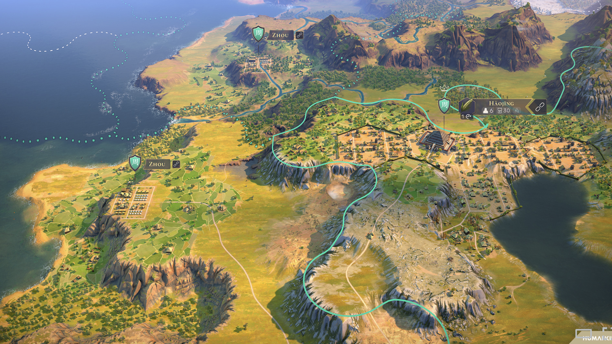
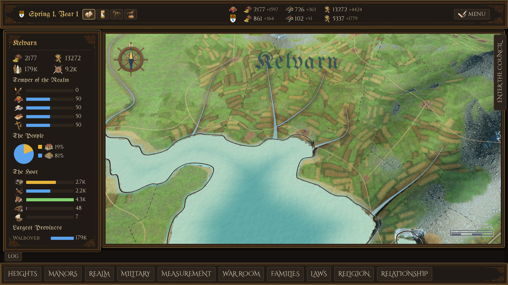
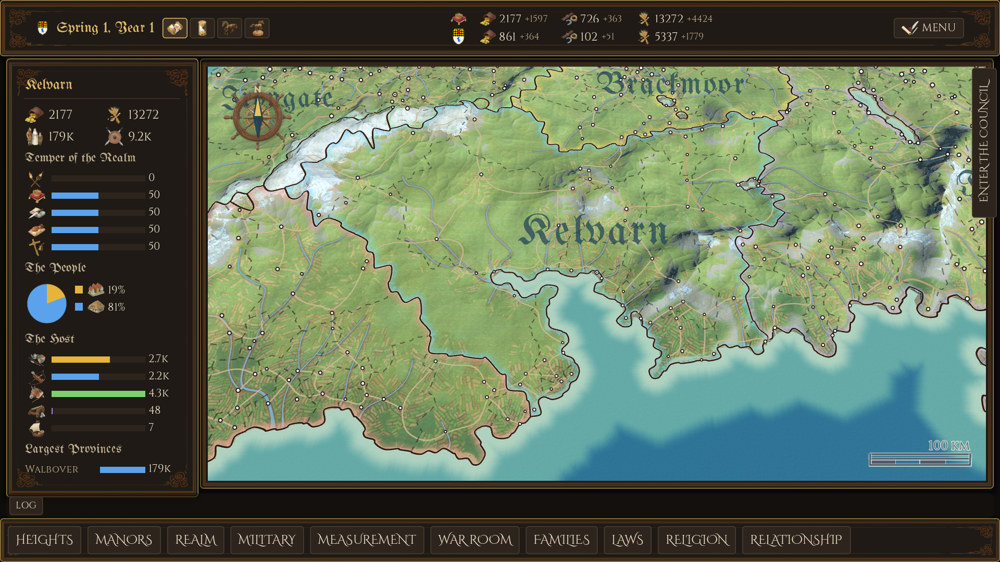

# The 3D map against a Humankind-style reference: gap, feasibility, route

Status: APPROVED ROUTE (owner 2026-09-24, §6): Forward+ yes, sea natural
near / bands far yes, trees deferred, and the route runs NOW, ahead of PRD
§6's gameplay steps ("美术也很重要"). Phase 0 is next.

*Target: the owner's reference, `docs/references/map_look/target_humankind.png`
(a Humankind campaign-map screenshot).*

| Current, camera 6 km from the capital | Current, 25 km (the opening zoom is 24 km) |
|---|---|
|  |  |

*Shot with `tools/snapshot_screen.tscn -- --screen root --zoom3d 6000|25000
--resolution 1920x1080 --shot-frame 90` on `feat/handmade-houses` (2026-09-24), pack
`beria`, tier high.*

## 1. Verdict

**Feasible in kind, not in fidelity.** At the mid zoom the reference is shot
from (a few km, oblique), we can reach the same *family* of look — a tilted
view with a horizon, relief you can read as cliffs and plateaus, woods
everywhere, dark natural water, towns that read as towns, thin glowing
borders — on the current stack, with a Godot renderer switch and roughly
four focused phases of work. My estimate is **~70% of the reference's
impact** at that zoom, and closer at the far zoom, where the reference has
nothing we lack.

What we will **not** match: Humankind's map is authored by an art team on
a tile grid — every cliff, rock outcrop and town district is a hand-made
asset placed by a person or by a tool built for exactly that map. Ours is
generated from an Azgaar export (a 2560 × 929 px pack, built at 50 m per
px = a 128 × 46 km island, heights 0–2400 m, Terrain3D at 20 m per
vertex). Procedural terrain can imitate the vocabulary (terraces,
escarpments, rock faces) but not the composition.

## 2. Where the look comes from — gap by gap

Ordered by how much of the reference's impression each carries.

### 2.1 Rendering pipeline — the single biggest lever

| | Reference | Current |
|---|---|---|
| Renderer | deferred PBR, SSAO, bloom, colour grading, aerial haze | Godot **GL Compatibility** (`project.godot` `rendering_method="gl_compatibility"`) |
| Ambient occlusion | strong: valleys and cliff bases darken | none (unsupported) |
| Atmosphere | distance haze and a bright horizon | `map3d_fog_density` 8e-7 — effectively off |
| Grade | warm, saturated, contrasty | Filmic tonemap, flat and cool |

Why it matters: most of what reads as "rich" in the reference is light —
the occlusion in every valley, the sunlit cliff faces against dark ones,
the haze that separates near from far. Compatibility cannot do SSAO,
SSIL, volumetric fog, glow of quality or AgX/ACES grading.

**Approach.** Switch to **Forward+** (the desktop renderer; the game ships
on desktop). Then: SSAO + SSIL, depth fog / aerial perspective, AgX
tonemap, an adjustment LUT, glow. Everything tuned stays data
(`balance.csv` / a new `map3d_env.csv`).

**Cost and risk.**
- Every shader written around a Compatibility trap must be re-checked:
  the raw-sRGB colour uniforms (sea, rivers, heat ramp, manor LUT), the
  emission-gamma fits to Filmic (`map3d_*_emission_gamma`), and the
  alpha-scissor split between `cloud_deck` and `cloud_shadow`. Expect
  every water/line colour to be re-fitted against its palette hex.
- Performance: high tier already measures 9.05 ms plain and 12.30 ms
  under MANORS panning, against an 8 ms budget (`tools/map3d/README.md`,
  Open items). Forward+ is faster per light and per material but
  SSAO/SSIL/fog cost real time; the `graphics_quality.csv` tiers will need
  new columns (ssao, ssil, fog, glow) and low may stay on Compatibility.
- The Terrain3D addon supports Forward+ (it is its primary target).

**Feasibility: high. Effort: medium (a spike day, then ~3–5 days of
re-tuning). Impact: very high.**

### 2.2 Camera

| | Reference | Current |
|---|---|---|
| Pitch at mid zoom | ~35–40° from horizontal, horizon in frame | near top-down: `map3d_pitch_near_deg` −32 only at 400 m, easing to `map3d_pitch_far_deg` −68 |
| Sky | visible at the top of frame | never seen |

At 6 km we look almost straight down, so relief cannot cast or show its
faces, and there is no depth cue at all. **Approach:** reshape the pitch
curve (hold ~−38° across the near and mid range, steepen only past
~30 km), show the sky, and let 2.1's haze do the depth. The picker,
labels and HUD already project through `Map3DContext`, so a pitch change
is data, but label and badge culling and the per-pose cuts must be checked
at an oblique angle (more ground in view → more instances; the house
budget per tier already caps that).

**Feasibility: high. Effort: small (1 day incl. checks). Impact: high —
and it makes every other improvement visible.**

### 2.3 Terrain relief: cliffs, plateaus, escarpments

| | Reference | Current |
|---|---|---|
| Landform | terraced plateaus, vertical escarpments, canyons, rock spires | smooth rolling field: Azgaar cell heights, blurred (`map_relief_blur_px` 4) plus ridged noise (`map_relief_detail_*`) |
| Steep ground | layered rock faces with strata | a grey rock texture on slope (right edge of the 6 km shot) |

This is the gap that most separates "a game map" from "a relief map".
Three layers of work:

1. **Shape (bake).** In `bake_world.py`, terrace the height field into
   plateaus along a few height bands and turn band edges into steep
   escarpments (a quantise-and-smoothstep on height, masked by a noise
   field so not every contour becomes a cliff; held off rivers and coast
   as the relief detail already is). At 20 m per vertex a cliff is at
   least one vertex wide — fine at mid zoom, soft at 400 m.
2. **Surface (shader).** Triplanar rock with strata on slopes above a
   threshold, in the patched Terrain3D shader (the same one that already
   carries the manor tint and heat ramp). Without triplanar mapping, a
   vertical face stretches its texture into streaks.
3. **Dressing (meshes).** Rock outcrops and cliff-edge boulders as a
   MultiMesh scatter along the escarpment lines, CC0 or hand-modelled in
   Blender (never AI-generated 3D — owner 2026-09-24).

Risks: the engine's heights (`Elevation.metres_of_cell`, height in
battle and supply) must stay the CELL's — the terracing is look only,
as the ridged detail already is; seating of houses and regiment pieces
reads the rendered ground and will follow. Settlements must not land on
a cliff (`bake_houses._footprint_drop` already refuses steep sites).

**Feasibility: medium. Effort: large (1–2 weeks with look review).
Impact: very high.**

### 2.4 Vegetation

| | Reference | Current |
|---|---|---|
| Trees | dense woods, copses, hedgerow trees, scattered bushes everywhere | **none on the 3D map** |

`tools/map3d/plant_trees.gd` is a 2026-09-17 spike (impostor cards) and
the pipeline README records **"owner: no trees"** (step 7). That ruling
was made when trees were flat cards on a top-down map; the reference
shows trees are half of its texture. **This needs the owner to revisit
the ruling** (§6).

**Approach.** A `Map3DLayerTrees`: one MultiMesh per species, 3D models
close in and octahedral impostors far out, placed in the bake from the
biome weights and a forest-cover field (seeded; never in water, never on
roads or house plots — the same structural guarantees `bake_houses.py`
has), budgeted per tier like houses. Models: Poly Haven / CC0 trees or
hand-made low-poly in Blender.

Risk: this is the biggest performance item after the renderer. Hundreds
of thousands of instances need the impostor LOD and per-tier budgets from
day one.

**Feasibility: high. Effort: medium–large (1–1.5 weeks). Impact: very
high.**

### 2.5 Ground materials and colour

| | Reference | Current |
|---|---|---|
| Palette | warm yellow-green, saturated, painterly | cool green, desaturated, noisy |
| Fields | small irregular plots, hedged, varied greens and golds | long straight strips (`map3d_fields.csv`), hard edges, brown/green only |
| Texture | hand-painted look, low-frequency variation | photo textures, high-frequency noise that averages to grey |

**Approach.** Re-texture the Terrain3D set toward a stylised painted look
(CC0 bases, re-tinted by `textures.py`-style tooling; Flux can make
TILEABLE 2D ground textures — images, which stay allowed); re-shape
`export_manor_land.gd` / `sow_patchwork` fields into smaller, irregular
plots with hedge lines; a warmer grade (2.1). All values in
`map3d_bake.csv` / `map3d_fields.csv` / `terrain_palette.csv`.

**Feasibility: high. Effort: medium (~1 week, mostly look iteration).
Impact: high.**

### 2.6 Water

| | Reference | Current |
|---|---|---|
| Sea | deep natural blue, shore foam, visible waves | four flat bands by distance from shore, pale mint to blue (**owner ruling, SCHEME C**) |
| Lakes | dark, reflective | sea bands |
| Rivers | thin, in their valleys | wide light ribbons (drawn wider than life on purpose) that read as glass at 6 km |

The sea look is an **owner ruling**, not a gap in skill: SCHEME C was
chosen for a map-like read. The reference wants the opposite. Options:
(a) natural water everywhere; (b) **natural near, bands far** — blend by
camera distance, so the strategic zoom keeps the map read (recommended);
(c) keep bands. Forward+ also gives screen-space reflection for lakes.
Rivers: narrower and darker near, the current width kept only far out
(the width is already driven by metres per screen px).

**Feasibility: high. Effort: small–medium (3–5 days). Impact: medium–high.
Needs the owner's ruling.**

### 2.7 Settlements

| | Reference | Current |
|---|---|---|
| Scale | towns hugely exaggerated against the land | houses at 2× life (owner 2026-09-21), still specks at 6 km |
| Form | walls, districts, street grid, a monumental centre | lane-grown clusters (`bake_houses.py`), landmark at the centre |

The house pipeline is in place (hand-modelled Blender houses, ~25,000
placed). **Approach:** a further, zoom-aware scale-up of the settlement
as a whole, town walls for the city and capital groups (a new wall mesh
following the cluster's hull), a visible street plan, the centre
landmark larger still. Iterative, reuses everything.

**Feasibility: high. Effort: medium. Impact: medium.**

### 2.8 Overlays (borders, city plates)

| | Reference | Current |
|---|---|---|
| Land border | one thin glowing teal line, smooth | realm band + halo + ink line (implementer's recommendation of 2026-09-19, never confirmed) |
| Sea border | dotted | none at sea |
| City marker | shield + name plate + stats, on a stem | kingdom names in large blackletter; settlements unlabelled until hovered |

All of these are existing data-driven layers (`Map3DBorders`,
`border_line.gdshader`, `MapLettering`, `HouseArms`). A banner per
settlement (its house's arms from `HouseArms`, name, people/garrison) is
the one new HUD piece.

**Feasibility: high. Effort: small–medium. Impact: medium.**

## 3. Summary table

| # | Gap | Feasibility | Effort | Impact | Blocked on |
|---|---|---|---|---|---|
| 2.1 | Renderer (Forward+, AO, haze, grade) | high | M | ★★★★★ | owner: renderer |
| 2.2 | Oblique camera + sky | high | S | ★★★★ | — |
| 2.3 | Cliffs / plateaus / rock | medium | L | ★★★★★ | — |
| 2.4 | Trees | high | M–L | ★★★★★ | owner: "no trees" ruling |
| 2.5 | Ground textures, fields, colour | high | M | ★★★★ | — |
| 2.6 | Water | high | S–M | ★★★ | owner: SCHEME C |
| 2.7 | Settlement scale and form | high | M | ★★★ | — |
| 2.8 | Borders, city banners | high | S–M | ★★★ | — |

## 4. Recommended route

Each phase ends with the visual-review loop
(`.claude/skills/visual-review/`): the SAME camera poses shot before and
after, side by side with the reference, and the bench
(`tools/map3d/bench.gd --pan`) against every tier's budget.

**Phase 0 — spike, 1–2 days, on a branch, throwaway allowed.**
Switch to Forward+; pitch curve to ~−38° at mid zoom with sky; SSAO,
depth haze, AgX. (A crude tree scatter was planned here; trees are
deferred by the owner, §6.)
Shoot three fixed poses (2, 6, 25 km) against the reference. *Exit:* the
owner judges whether the direction is worth the route. This phase
answers the whole question cheaply; nothing after it is worth starting
without that answer.

*Phase 0 result (2026-09-24,
`docs/references/map_look/phase0_before_after.png`):* Forward+ on, AgX with
saturation 1.3 / contrast 1.1 (the independent critic ranked it over Filmic
and ACES), the camera tilted (−22° near to −55° far, ~−37° at 6 km), depth
haze from 1.1 to 4 camera distances, SSAO at 3% of the distance, the realm
band thinner and fainter and the halo gone (Forward+ blends in linear, so the
band glowed and the halo became a tray). Found on the way: panning cost
~48 ms a frame at mid/far zoom under EITHER renderer — the houses layer
re-sampled a 5×5 ground grid under every visible house on each rebuild — now
cached per house (high tier pan 8.1 ms mid/far, 8.7 ms near; MANORS 10.8 ms).
Still wrong, by the critic and by eye: the land reads darker and more olive
than the reference's warm gold-green, the mid-zoom sea is milky and lighter
than the land, the kingdom names sink into the dark ground, and the far
zoom's road web and white dots are clutter.

**Phase 1 — foundation, ~1 week.**
Make Forward+ real: re-fit every shader colour to its palette hex, add
the environment's values to data, extend `graphics_quality.csv` (ssao,
ssil, fog, glow; low tier possibly kept on Compatibility or with effects
off), re-baseline the bench. Ship the camera curve. *Exit:* every tier
within budget, the suite green, no colour regressions against the
palettes.

**Phase 2 — the land, ~2–3 weeks.**
Terracing and escarpments in the bake, triplanar rock, rock scatter
(2.3); the ground texture set, field shapes and grade (2.5). The heaviest
look iteration; done together because rock and ground are judged
against each other. *Exit:* the owner's look approval at the three poses.

**Phase 3 — life, ~1.5–2 weeks.**
The tree layer with impostor LOD and tier budgets (2.4); the water
decision implemented (2.6). *Exit:* bench within budget on panning with
trees at their densest.

**Phase 4 — the human layer, ~1–1.5 weeks.**
Settlement scale-up, walls and street plan (2.7); borders and city
banners (2.8).

Rough total after the spike: **6–9 weeks** of focused sessions, the
largest uncertainty being Phase 2's look iteration.

**Build order.** CLAUDE.md holds PRD §6 strictly: this work is *art
integration*, the last step of that order. It should either wait until
the gameplay steps before it are done, or be taken up by the owner's
explicit decision to reorder. Phase 0 alone is small enough to run as a
direction check without disturbing the order.

## 5. Risks

- **Performance.** Already over budget on high while panning. Forward+,
  AO, trees and a more oblique camera (more ground in view) all push the
  same way. Mitigation: per-tier budgets from the first commit of each
  feature, impostors, and the bench's `--pan` rows as the gate.
- **Shader re-tuning.** Every Compatibility workaround is a place where
  Forward+ will look different. Budgeted in Phase 1.
- **Owner rulings.** Three current rulings (Compatibility, SCHEME C sea,
  no trees) stand between the current map and the reference; each must be
  revisited explicitly, not eroded.
- **Asset licensing.** No AI-generated 3D (owner 2026-09-24). Trees, rocks
  and walls come from CC0 libraries or are hand-modelled in Blender; 2D
  textures from Flux or CC0 are fine.
- **Composition.** Procedural terrain lacks the authored beauty of a
  designed map. Terracing and rock dressing narrow the gap but will not
  close it; accept that up front.

## 6. Owner decisions (2026-09-24)

1. **Renderer: YES** — the 3D map moves to Forward+ (low tier may stay on
   Compatibility if it cannot hold its budget).
2. **Sea: YES** to the recommendation — natural water near, SCHEME C's
   bands far, blended by camera distance.
3. **Trees: DEFERRED** — the "no trees" ruling stands for now; Phase 0
   runs without the tree scatter and Phase 3's tree layer waits for a
   ruling.
4. **Priority: REORDERED** — this route runs now, ahead of PRD §6's
   remaining gameplay steps ("美术也很重要").

The questions as they were put:

1. **Renderer:** may the 3D map move from GL Compatibility to Forward+
   (keeping Compatibility for the low tier if needed)?
2. **Sea:** replace SCHEME C's four bands, or blend natural water near
   into bands far (recommended), or keep the bands?
3. **Trees:** lift the "no trees" ruling for the 3D map?
4. **Priority:** run Phase 0 now as a direction check, and schedule
   Phases 1–4 as art integration after PRD §6's gameplay steps, or
   reorder?
