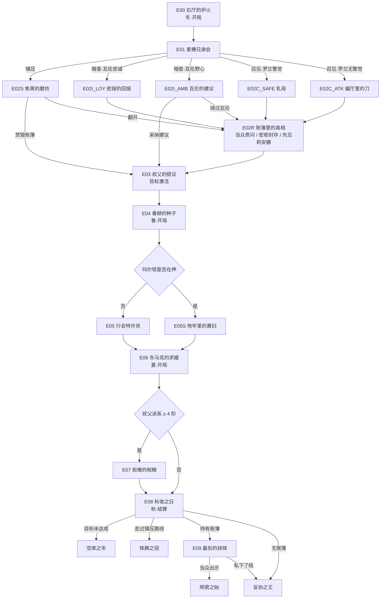

# 第一章设计文档 · 灰麦之冬

Our Grand Ages — Chapter 1 Design Doc
版本 1.0 ｜ 状态：内容已定稿，待实现

---

## 0. 一句话概括

新王登基第七日，情报官报告一个行省城镇出现秘密结社；玩家在四个季度内查明真相、稳住经济、处理与叔父的权力冲突，并在秋收时接受结算。

**本章无 LLM 功能。** 所有叙述为预写文本，所有玩家输入为固定选项按钮。本章同时承担新手教程职责：玩家在受控的选择中熟悉经济、派系、人物三套系统，自由指令留待后续章节引入。

---

## 1. 设计目标

| 目标 | 手段 |
|---|---|
| 教学 | 每个事件只引入一个系统概念：粮仓、国库、动乱度、贸易、派系阶梯、特质 |
| 建立基调 | 政治阴谋而非战争；道德困境没有标准答案 |
| 验证系统 | 本章是派系升级阶梯的第一个完整用例，也是标志位驱动叙事的第一次落地 |
| 可复现 | 全部判定走确定性模拟，存档可完全复现 |
| 留钩子 | 结局埋下堂兄、瓦伦忠诚、兄弟会转入地下三条后续线索 |

---

## 2. 剧情梗概

先王死于北境战争之后，国库只剩三千二百金币。冬至前夜的第一次内阁会议上，情报总管瓦伦报告：河谷行省的灰麦镇出现名为"麦穗兄弟会"的秘密结社，截获的信中写着"待到冬尽，粮仓当归于播种之人"。

玩家的叔父、河谷行省总督埃德里克公爵主动提出代为处理。他的从容过于反常。

无论玩家选择镇压、暗查还是召见，都可能拿到同一件东西：一本手抄账簿。它揭示过去三年河谷行省瞒报了近四成收成，差额经财务大臣奥斯瓦尔德之手，卖给了曾与先王为敌的东马克。所谓秘密结社，只是磨坊工和织工私下凑粮互助，熬过两个饥荒冬天。

账簿边缘有玩家妹妹莉安娜的批注——她一直在用嫁妆资助兄弟会，却从未告诉哥哥。

叔父随后要求继续掌管河谷储粮。玩家若要收回这份权力，必须在明年秋收前用数字证明王室管得更好。此后四个季度里，春耕的种子粮、行会特许状、东马克的联姻提议、夏末拒缴的税粮，每一个节点都在权力、金钱、民心和亲情之间做交换。

秋收之日，账目摊开在长桌上，答案由玩家四个季度的经营结果给出。

---

## 3. 人物

| 角色 | 身份 | 在本章的作用 | 建议特质 |
|---|---|---|---|
| 玩家 | 新王 | 不露脸，只以背影和手部出现，便于代入 | — |
| 埃德里克公爵 | 叔父，河谷行省总督 | 主要对手。不是恶棍，是一个认为自己在替侄儿扛担子的贪婪长辈 | 贪婪、圆滑 |
| 莉安娜 | 妹妹 | 亲情线。她的善举必须瞒着哥哥，这是本章最私人的背叛 | 仁慈 |
| 玛尔塔 | 兄弟会首领，玩家幼时乳母 | 道德标尺。她的最后一问是"妥协之王"结局的重量 | 固执 |
| 瓦伦 | 情报总管 | 不确定因素。特质决定他是失察还是同谋 | 忠诚 / 野心（二选一） |
| 奥斯瓦尔德 | 财务大臣 | 叔父的白手套，负责边境走私账目 | 贪婪 |
| 罗兰 | 侍卫统领 | 特质决定召见路线是否发生刺杀 | 警觉 / 无 |

**尚未确定的设定**：堂兄（叔父之子）在"明君之始"结局的背景里出现，但本章没有姓名和台词，留给第二章。

---

## 4. 结构与分支



共 16 个事件、4 个结局。穷举所有选项、特质分支与目标达成情况，共 2,568 条不同路径，四个结局全部可达，无死锁。

---

## 5. 经济目标：灰麦之约

目标在 E03 激活，在 E08（第 3 回合结束）结算。

| 指标 | 目标 | 起始值 | 事件之外还需模拟产出 |
|---|---|---|---|
| 河谷行省粮仓储备 | ≥ 12,000 石 | 4,000 | 最佳路径 +3,000，最差路径 +9,500 |
| 王室国库 | ≥ 5,000 金币 | 3,200 | 最佳路径 +1,200，最差路径 +3,650 |
| 灰麦镇动乱度 | < 40 | 35 | 仅计事件时终值 15 ～ 95 |
| 灰麦镇贸易收入 | ≥ 600 / 季 | 300 | 最佳路径 +50，最差路径 +450 |

### 数值设计逻辑

四个指标互相牵制，任何单一策略都无法同时满足：

- **加税**补国库，推高动乱度
- **没收叔父私仓**一次性补足粮仓，但派系阶梯跳两级，直接触发拒缴税粮
- **颁发行会特许状**恢复贸易，等于公开承认叔父治理失败
- **借出种子粮**让粮仓短期下降 1,500 石，但秋收收成 +25%；拒借则秋收 -30%

这四项之外，事件效果只提供了一部分，剩下的缺口必须靠玩家的经营行为补足。上表的"最佳路径"是所有事件选项对该指标最有利的组合，因此实际游玩中的缺口通常介于两列之间。

**平衡待办**：上表未计入收成修正（`harvest_pct`），因为修正值由模拟引擎计算。收成基数确定后，需要重跑一次 `validate_chapter.py --paths`，确认最佳路径不会让目标变得过于轻松，也确认最差路径不会变成必败。

### 关键取舍节点

| 回合 | 事件 | 取舍 |
|---|---|---|
| 冬 | E03 叔父的提议 | 接受则粮食持续被抽走 25%；拒绝则花 400 金币并推高派系阶梯 |
| 春 | E04 春耕的种子 | 短期储备 vs 秋收收成 |
| 春末 | E05 行会特许状 | 贸易收入 vs 与叔父彻底撕破脸；可选抽成版本，收益减半但王室每季得 150 金币 |
| 夏 | E06 东马克的求婚 | 600 金币聘礼与叔父好感 vs 妹妹与证人。第三选项"将计就计"需已揭开账簿，截断走私，粮仓 +2,000 |
| 夏末 | E07 拒缴的税粮 | 发兵（1,000 金币，粮仓 +3,000）/ 谈判（800 金币）/ 分送账簿抄本（不花钱，但需要证据与证人俱在） |

注意 E09 的 1,500 金币补偿发生在目标结算之后，不能用来达成目标。这是刻意设计：不允许用出卖真相来补足数字。

---

## 6. 四个结局

| 结局 | 触发条件 | 含义 | 后续钩子 |
|---|---|---|---|
| 明君之始 | 目标达成 + 持有账簿 + 当众出示 | 叔父被废，奥斯瓦尔德下狱，河谷忠诚度 +20 | 堂兄记恨（`cousin_resentful`） |
| 妥协之王 | 目标达成 + 私下了结，或从未拿到账簿 | 王国安稳，真相被埋。玛尔塔的最后一问 | 叔父体面退休（`uncle_retired`） |
| 铁腕之冠 | 目标达成 + 走过镇压路线 | 数字漂亮，灰麦镇只剩恐惧 | 兄弟会转入地下（`brotherhood_underground`），动乱度下限 +25 |
| 空库之冬 | 目标未达成 | 叔父联合领主逼宫 | `coup_pending`，派系阶梯 +2 |

"铁腕之冠"优先于账簿判定：即使镇压路线后翻开了账簿，结局仍是铁腕。设计意图是镇压的代价不可赎买。

---

## 7. 给代码实现

### 文件与加载

| 文件 | 内容 |
|---|---|
| `chapter1_events.json` | 事件、选项、效果、结局、目标 |
| `chapter1_texts.csv` | 全部预写文本（`text_id, speaker, zh`），88 行 |
| `chapter_events.schema.json` | 格式契约，后续章节复用 |
| `validate_chapter.py` | 静态校验 + 全路径遍历 |
| `illustrations_manifest.csv` | 20 张插图 + 6 张角色参考的提示词 |

建议实现一个 `ChapterRunner`：读取 JSON 与 CSV，按回合和阶段调度事件，执行效果，将标志位与变量写入存档。

### 效果类型（共 8 种）

`add` / `set`（变量）、`set_flag` / `clear_flag`、`add_modifier` / `remove_modifier`、`activate_objective`、`set_turn_granularity`。

### 需要引擎实现的修正目标

`province.hegu.harvest_pct`、`province.hegu.grain_income_pct`、`province.hegu.tax_to_crown_pct`、`province.hegu.loyalty`、`royal.income_flat`、`settlement.greywheat.unrest_floor`。

### 待对齐的占位 ID

- 特质：`vigilant`、`ambitious` → 映射到现有特质表
- 议会席位：`spymaster`、`treasurer`、`captain_of_guard` → 映射到现有席位
- 地理：`hegu`（河谷行省）、`greywheat`（灰麦镇）→ 映射到地图管线生成的行省与城镇

### 边界情况

- E07 触发时会把回合粒度切到按月推进，三个选项都会移除拒缴税粮的修正
- `objective` 条件在遍历脚本中作为参数测试两种情况，游戏中由引擎对目标的四项检查求值
- 每个事件都保证至少有一个无条件选项，不会出现无选项可点的死锁；校验器会检查这一点

### 校验命令

```bash
python validate_chapter.py chapter1_events.json chapter1_texts.csv \
  --schema chapter_events.schema.json \
  --illustrations illustrations_manifest.csv \
  --paths
```

当前结果：0 错误、0 警告，20 张插图全部挂接，四个结局全部可达。任何内容改动后应重跑此命令。

---

## 8. 给美术

20 张剧情插图与 16 个事件、4 个结局一一对应，另有 6 张角色参考图用于保证人物一致性。全部提示词在 `illustrations_manifest.csv`，风格与角色外观锚点在 `illustration_style_bible.json`。

**风格**：写实历史油画，柔边笔触，低饱和的土褐、赭石、板岩灰与暗红，13 世纪北欧风物，与地图美术保持一致。

**一致性要点**：

- 国王不露脸，只出现背影或手部
- 每个角色的外观描述以同一段文字复用到所有相关画面
- 标志物需保持稳定：叔父的绿宝石金戒、玛尔塔的麦穗别针、瓦伦的银钥匙吊坠、王室的蓝底银塔、东马克的红底白鹿、兄弟会的麦捆

**分级考虑**：E02C_ATK 的刺杀和 E02S 的焚镇均不表现血迹与尸体。

**尺寸待定**：目前按 1344×768（约 16:9）设计构图。事件弹窗的实际比例确定后，若差异较大，需连同构图描述一起调整，避免裁剪丢失画面重点。

有两张图服务于同一事件的多个文本变体：`C1_IL10`（春耕，玛尔塔来信 / 老人求援）、`C1_IL13`（求婚，已知 / 未知莉安娜参与）。

---

## 9. 未完成事项

1. 收成基数确定后重跑平衡遍历
2. 占位 ID 映射到特质表、席位表、地图数据
3. `ChapterRunner` 实现与存档格式
4. 事件弹窗 UI 比例确定后调整插图尺寸
5. 堂兄的姓名与第二章衔接
6. 音效与音乐节点（本章暂未规划）
